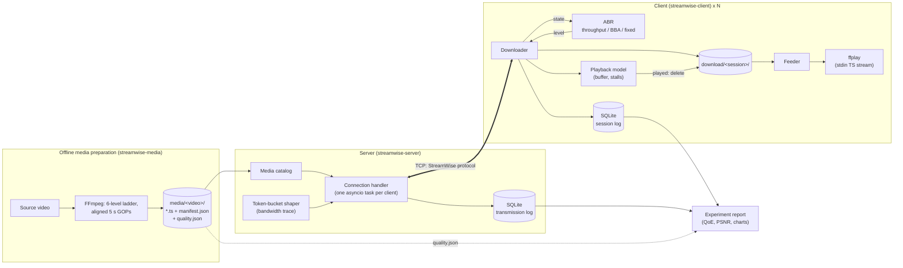
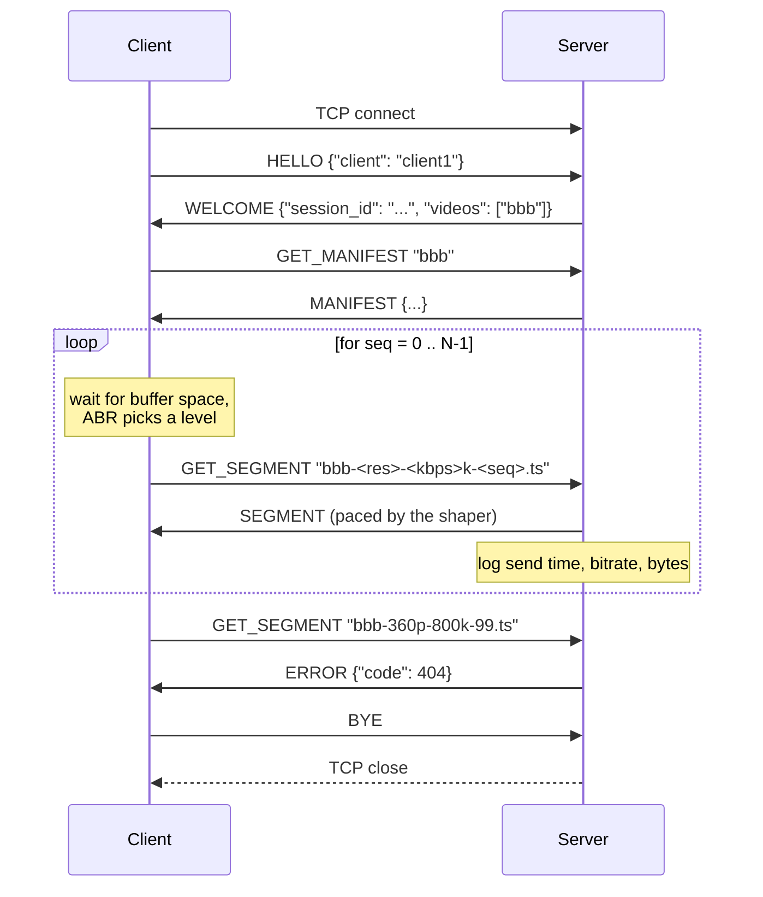
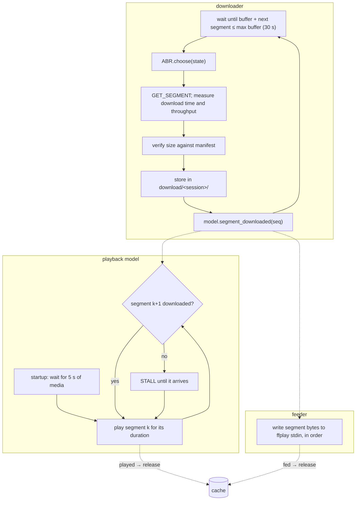
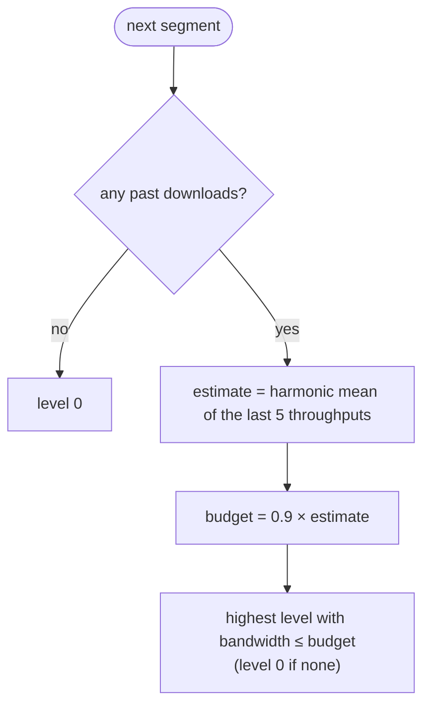
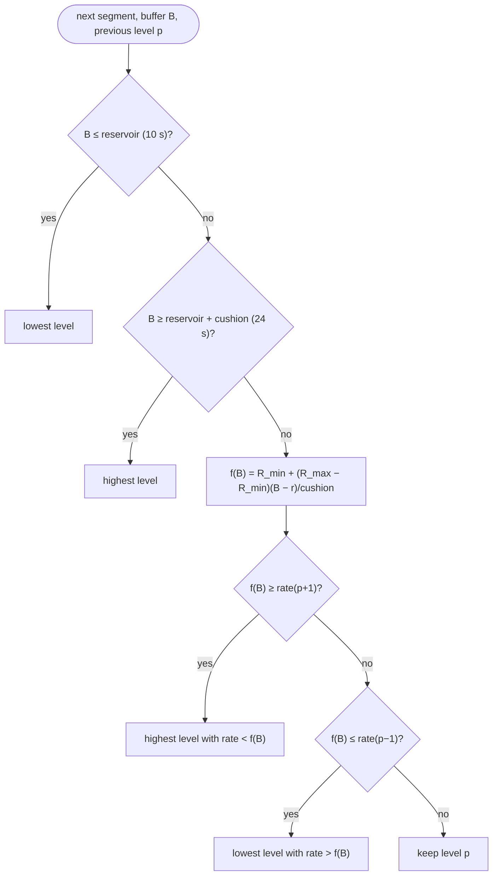

# StreamWise Design Document

This document describes the architecture, the segment protocol, the server and client
internals, and the ABR algorithms of StreamWise. Requirement IDs (e.g. `S-02`) refer to the
[requirement checklist](requirements.md).

## 1. System Architecture



| Component | Module | Responsibility |
| --- | --- | --- |
| Media preparation | `streamwise.media` | Transcode, segment, verify, write manifest, measure PSNR |
| Protocol | `streamwise.common.protocol` | Message framing, integrity check, limits |
| Server | `streamwise.server` | Concurrent request handling, shaping, transmission log |
| Client | `streamwise.client` | Download loop, playback model, player, cache, session log |
| ABR | `streamwise.abr` | Bitrate decision behind one interface |
| Metrics | `streamwise.analysis.metrics` | Rebuffering, bitrate, switches, QoE |
| Experiments | `streamwise.experiments` | Scenario runner, traces, report and charts |

## 2. Media Preparation (V-01 to V-06)

The source is Big Buck Bunny (Blender Foundation, CC BY 3.0), 1080p at 30 fps; StreamWise
uses 180 s starting at 0:30, which gives 36 segments of 5 s.

| Level | Resolution | Nominal | Measured bandwidth¹ | Mean segment PSNR² |
| --- | --- | --- | --- | --- |
| 0 | 426x240 | 400 kbps | 600 kbps | 35.06 dB |
| 1 | 640x360 | 800 kbps | 992 kbps | 37.66 dB |
| 2 | 854x480 | 1200 kbps | 1383 kbps | 39.74 dB |
| 3 | 1280x720 | 2500 kbps | 2654 kbps | 43.41 dB |
| 4 | 1920x1080 | 5000 kbps | 5038 kbps | 49.19 dB |
| 5 | 1920x1080 | 8000 kbps | 7969 kbps | 51.55 dB |

¹ All segment bytes (video, 128 kbps AAC audio, MPEG-TS overhead) divided by the duration.
² Against the source at 1920x1080 (see §7).

The 240p rung was added after the first evaluation round. Without it, the lowest level
needed 0.99 Mbit/s once audio and container overhead were counted. A 1 Mbit/s link (one of
the required scenarios) then had no sustainable level, and every algorithm stalled
repeatedly. The lowest rung must sit clearly below the slowest link the service should
support.

**Segment alignment.** Switching levels at a segment boundary only works if every level
has its boundaries at the same frames and every segment starts with an IDR frame. The
encoder therefore uses a fixed GOP of exactly one segment (`-g 150 -keyint_min 150
-sc_threshold 0`) and forces a key frame at every multiple of 150 frames.

**Frame-based cutting.** The FFmpeg segment muxer's time-based cutting (`-segment_time`)
skipped the first boundary in our tests: the MPEG-TS muxer offsets timestamps by 1.4 s, and
audio starts slightly before video. Cutting by frame number (`-segment_frames 150,300,...`)
is exact. After encoding, every segment is checked with `ffprobe`: it must contain exactly
150 video frames, and its first packet must be a key frame.

**Concatenation across levels.** Each segment is muxed independently, so the TS continuity
counters restart in every file. Without further care a demuxer reports corrupt packets at
every boundary, even between segments of the same level. The segmenter sets the TS
*discontinuity indicator* on the first packet of each segment
(`mpegts_flags=+initial_discontinuity`). Timestamps are not reset between segments.
Segments of any levels can therefore be concatenated in order and decoded with zero errors,
which `tests/test_media.py` verifies.

**Manifest.** The segmenter writes `manifest.json` next to the segments. The client fetches
it first, and it lists the actual size of every segment:

```json
{
  "format_version": 1,
  "video": "bbb",
  "segment_duration": 5.0,
  "segment_count": 36,
  "segment_durations": [5.0, 5.0, "..."],
  "levels": [
    {"index": 0, "width": 640, "height": 360, "bitrate_kbps": 800,
     "segment_sizes": [534672, 624724, "..."]},
    "..."
  ]
}
```

Segment files are named `{video}-{height}p-{kbps}k-{seq}.ts`, for example
`bbb-1080p-8000k-0.ts`.

## 3. Segment Protocol (P-01 to P-03)

StreamWise uses its own binary request/response protocol over one TCP connection per
client. TCP provides ordering and reliability. An application-level CRC-32 additionally
verifies every payload end to end. A client may pipeline requests (send several before
the first response); the server answers them strictly in request order.

### 3.1 Message Format

```
 0               1               2               3
 0 1 2 3 4 5 6 7 0 1 2 3 4 5 6 7 0 1 2 3 4 5 6 7 0 1 2 3 4 5 6 7
+-------------------------------+---------------+---------------+
|          magic "SW"           |    version    |     type      |
+-------------------------------+---------------+---------------+
|                          request_id                           |
+---------------------------------------------------------------+
|                         payload_length                        |
+---------------------------------------------------------------+
|                         payload_crc32                         |
+---------------------------------------------------------------+
|                     payload (payload_length bytes) ...        |
```

| Field | Size | Meaning |
| --- | --- | --- |
| magic | 2 B | ASCII `SW`; rejects non-StreamWise peers immediately |
| version | 1 B | Protocol version, currently `1` |
| type | 1 B | Message type (table below); bit 7 (`0x80`) marks an encrypted payload |
| request_id | 4 B | Chosen by the client and echoed in the response |
| payload_length | 4 B | Payload size; limited to 4 KiB for requests and 256 MiB for responses |
| payload_crc32 | 4 B | CRC-32 (IEEE 802.3) of the payload (of the ciphertext if encrypted) |

All integers are unsigned and big-endian. The header is 16 bytes.

| Type | Value | Direction | Payload |
| --- | --- | --- | --- |
| `HELLO` | 1 | C → S | JSON `{"client": "<name>"}`, optionally `"encryption"` (key exchange offer) |
| `WELCOME` | 2 | S → C | JSON `{"session_id", "server", "videos"}`, optionally `"encryption"` (answer) |
| `GET_MANIFEST` | 3 | C → S | UTF-8 video name |
| `MANIFEST` | 4 | S → C | Manifest JSON |
| `GET_SEGMENT` | 5 | C → S | UTF-8 segment file name, e.g. `bbb-720p-2500k-7.ts` |
| `SEGMENT` | 6 | S → C | Raw MPEG-TS bytes |
| `ERROR` | 7 | S → C | JSON `{"code", "message"}` |
| `BYE` | 8 | C → S | empty |
| `GET_CHUNK` | 9 | C → S | `!QI` byte offset and length, then the UTF-8 segment file name |
| `CHUNK` | 10 | S → C | The requested bytes of the segment (at most 1 MiB) |

Error codes: `400` bad request (malformed message; the server then closes the connection),
`403` an encrypted request failed authentication, `404` unknown video or segment, `409`
unexpected message type, `416` invalid chunk range, `426` the server requires encryption,
`500` internal error.

**Sliding-window transport (extension E-03).** `GET_CHUNK`/`CHUNK` let a client fetch a
segment as fixed-size chunks with a sliding window over several connections; see
[sliding-window.md](sliding-window.md).

**Encryption (extension E-02).** If the client offers a key exchange in `HELLO` and the
server accepts it in `WELCOME`, every later message in both directions is encrypted with
AES-256-GCM: the type byte has bit 7 set, and the payload is ciphertext followed by a 16-byte
authentication tag. The handshake, key schedule and security properties are described in
[encryption.md](encryption.md).

### 3.2 Interaction



### 3.3 Robustness and Security

- **Framing errors.** A bad magic, an unknown version or type, a length over the limit, a
  CRC mismatch, or a truncated message raises a `ProtocolError`. The server answers with
  `ERROR 400` and closes only that connection.
- **No path traversal.** The server never joins a client-supplied name onto a path. It
  parses the name with a strict regular expression, looks the level up in the manifest, and
  builds the path from the manifest. A name such as `../x` cannot match.
- **Timeouts.** A peer must send `HELLO` within 10 s and then a request at least every
  120 s. The client aborts if no byte arrives for 30 s; a slow download that keeps making
  progress never times out.
- **Confidentiality and authenticity.** Optional end-to-end AES-256-GCM encryption with an
  X25519 key exchange and an optional pre-shared key; see [encryption.md](encryption.md).
- **Integrity at startup.** The server checks every segment listed in each manifest for
  existence and exact size before it starts listening.

## 4. Server (S-01 to S-07)

- **Concurrency.** `asyncio.start_server` runs each connection as its own task, so many
  clients are served concurrently on one thread. A stalled or misbehaving client blocks only
  its own task, which `tests/test_streaming.py` checks with garbage input, an abrupt
  disconnect mid-transfer, and an idle connection.
- **Shaping.** Responses are written in chunks of at most 16 KiB. Before each chunk the
  connection's token bucket is asked for tokens. The bucket's fill rate follows a
  piecewise-constant `BandwidthTrace`, integrated exactly across rate changes, with bursts
  up to 32 KiB. The write chunk is capped at half the bucket size: tokens that accrue while
  a task oversleeps are capped at the bucket size, so a chunk as large as the bucket would
  lose them and undershoot the configured rate.
  - `--shaping-scope connection`: each client gets its own bucket, and its trace clock
    starts when it connects. Experiments use this mode so every client sees exactly its
    scenario.
  - `--shaping-scope global`: one bucket shared by all clients, with the trace clock
    starting at server start. This models a shared bottleneck link and is used in the live
    demo. A FIFO lock divides the bandwidth fairly among clients.
  - `--shaping-scope client`: one bucket per client name, shared by all connections of that
    client, with the trace clock starting at its first connection. This models a client's
    access link for the multi-connection sliding-window transport.
- **Pipelining.** A reader task queues up to 256 requests per connection while the
  connection task answers them in order. `--delay-ms` answers each request no earlier than
  that long after it arrived (an emulated round-trip time). `--reset-after-s` aborts every
  connection that long after it opened (fault injection).
- **Transmission log (S-04).** Every segment response is recorded in SQLite
  (`transmissions`): session, request ID, segment, sequence number, level, resolution,
  bitrate, bytes, start and end time (Unix time), duration, throughput, and status (`ok`,
  `not_found`, `aborted`). A separate `sessions` table records peer, client name, connect and
  disconnect times, and the close reason. A background thread performs all writes, so disk
  I/O never distorts the transfer timing.
- **Shutdown (S-07).** SIGINT/SIGTERM stops the listener, cancels the active connections,
  and flushes the log.

## 5. Client (C-01 to C-10)

Three concurrent tasks share one **playback model**:



- **Playback model.** The model is the authoritative playback clock. Media time advances
  in real time while playing; the buffer level is media downloaded minus media played.
  Playback starts once 5 s are buffered (the *startup delay*). A stall begins at the exact
  moment the playhead reaches the end of the buffered media and ends at the exact arrival
  time of the missing segment. These times do not depend on when the task happens to wake
  up. Segment deadlines are chained (each segment starts at the previous deadline), so
  timing does not drift.
- **Player.** MPEG-TS is designed to be concatenated, so `ffplay` receives one continuous
  stream on its standard input. Writes block once ffplay's internal queues are full, so the
  feeder runs at the player's pace. A small probe size lets playback start after the first
  segment. If the window is closed, the session continues headless.
- **Cache (C-08).** Each session writes to its own directory, `download/<session-id>/`, so
  concurrent clients never collide. Files are written to a temporary name and then renamed.
  A segment is deleted when both the playback model and the player have released it. When
  the session ends (completed, failed, or Ctrl-C), in-flight writes are awaited and the
  directory is removed, together with `download/` if no other session is still using it.
- **Session log (C-09).** The client writes to SQLite: per segment, the level, bytes, wait
  time, request, first-byte and completion times, throughput, and the buffer before and
  after the download; each stall; and a per-session summary with all metrics from §7.
- **Headless mode (C-10).** `--player none` skips the window. Timing is still real time,
  because the network is real.

## 6. ABR Algorithms (C-06, C-07)

All algorithms implement `AbrAlgorithm.choose(state) -> level`. The state contains the
segment index, the manifest, the buffer level, the previous level, and the throughput and
download-time history. Algorithms are created from spec strings such as
`throughput:window=5,safety=0.9`, so a learning-based ABR can be added later without
touching the client. Rates are compared using each level's **measured bandwidth** from the
manifest rather than its nominal encoder bitrate: the network has to carry audio and TS
overhead too, which adds 50 % at level 0 (600 vs. 400 kbps).

### 6.1 Throughput-based (rate-based)



The harmonic mean (as in FESTIVE and MPC) is dominated by low samples, which makes it robust
to short throughput spikes. The safety factor leaves headroom for estimation error.

### 6.2 Buffer-based (BBA-0, Huang et al., SIGCOMM 2014)



BBA does not use throughput estimates at all: the buffer level itself carries the
information. The hysteresis band (switch only when `f(B)` crosses a neighbouring rate)
prevents oscillation.

**Parameters.** With 5 s segments and a 30 s buffer cap, the defaults are a 10 s reservoir
and a 14 s cushion:

- The reservoir covers two segments, so the client keeps the lowest level until the buffer
  can absorb one slow download.
- `reservoir + cushion = 24 s` stays below the download gate (a new segment is requested
  only when the buffer is at most 30 − 5 = 25 s), so the top level remains reachable.

The first evaluation used a 5 s reservoir (one segment). With it, BBA switched up while a
single download could still drain the buffer, and stalled 22 times on a 1 Mbit/s link. The
test report quantifies the choice with a sensitivity experiment
(`experiments/bba_sensitivity.toml`).

### 6.3 Fixed

`fixed:<level|min|max>` always requests one level. It serves as the non-adaptive baseline
in experiments.

### 6.4 Q-learning (extension E-01)

`qlearning` is a tabular Q-learning agent trained offline in a trace-driven simulator that
reproduces the client and server behaviour above. It uses the same interface, so the real
client runs it unchanged. The simulator, the agent, training, and evaluation are described in
[intelligent-abr.md](intelligent-abr.md).

## 7. Metrics and QoE

Metrics are defined in `streamwise.analysis.metrics`:

| Metric | Definition |
| --- | --- |
| Startup delay | Time from the first segment request until playback starts |
| Stall time / count | Frozen time after playback started (startup excluded) |
| Rebuffering ratio | `stall_time / (played_media_time + stall_time)` |
| Average bitrate | Duration-weighted mean nominal bitrate of the played segments |
| Switches | Number of level changes, and the mean absolute bitrate change per switch |
| Session PSNR | Mean per-segment PSNR of the segments actually played |
| QoE | `Σ q(R_k) − μ·T_stall − μ_s·T_startup − Σ |q(R_k) − q(R_{k−1})|`, with `q(R)` in Mbit/s |

The QoE model is the linear one used by MPC (Yin et al., SIGCOMM 2015) and Pensieve
(Mao et al., SIGCOMM 2017). As in Pensieve, `μ` equals the top bitrate in Mbit/s (8), so one
second of stalling costs as much as one segment at top quality. `μ_s = μ`. The report shows
QoE per segment, so sessions of different lengths are comparable.

**PSNR measurement.** For each level, the concatenated segments are decoded, upscaled with
bicubic interpolation to the display resolution (1920x1080, the highest level), and compared
frame by frame with the same span of the source, resampled with Lanczos. Per-frame MSE values
are grouped into segments, and a segment's PSNR comes from its mean MSE.
`quality.json` stores the per-segment MSE and PSNR. For each level it also stores both
common aggregates (`psnr_of_mean_mse` and `mean_segment_psnr`), so the report always states
which one it uses.

## 8. Limitations and Possible Extensions

- Bandwidth is emulated in the application, at the sender. Loopback RTT is negligible, so
  latency effects are not modelled. Kernel-level emulation (`tc netem`) can be combined with
  the same code.
- One request is in flight per connection; HTTP/2-style pipelining is not needed for
  sequential segment fetching.
- The learning-based ABR (extension E-01) is trained in a simulator of this system; see
  [intelligent-abr.md](intelligent-abr.md).
