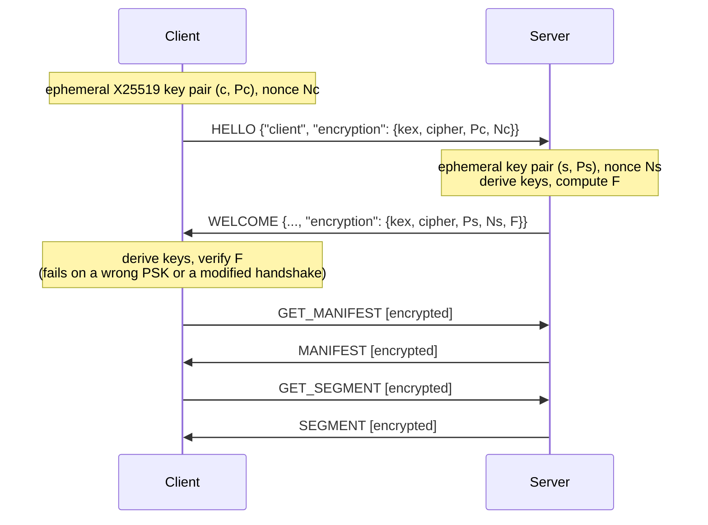

# Extension E-02: End-to-End AES Encryption

StreamWise can encrypt every message after the handshake with AES-256-GCM. The
keys come from an X25519 key exchange carried inside `HELLO`/`WELCOME`. An optional
pre-shared key (PSK) authenticates both peers. Encryption is end to end between the client
and server processes: the network, a proxy or a packet capture sees only ciphertext.

| Component | Location |
| --- | --- |
| Handshake, key schedule, record protection | `streamwise.common.crypto` |
| Header flag and error codes | `streamwise.common.protocol` |
| Server / client integration | `streamwise.server.app`, `streamwise.client.connection` |
| Tests | `tests/test_crypto.py` |
| Cost measurement | `streamwise-experiment crypto-bench`, `experiments/encryption.toml` |
| Wireshark | `tools/wireshark/streamwise.lua` |

## 1. Threat Model and Goals

| Goal | Mechanism |
| --- | --- |
| An eavesdropper cannot read segments, the manifest, or requested file names | AES-256-GCM on every message after `WELCOME` |
| Any change to a message is detected (payload or header) | GCM tag; the header is authenticated as associated data |
| Replayed, reordered, dropped or reflected messages are detected | Implicit per-direction message counters in the nonce; separate keys per direction |
| A recorded session stays secret if a long-term key leaks later | Ephemeral X25519 keys per connection (forward secrecy) |
| An active man-in-the-middle cannot impersonate the server or the client | Optional PSK mixed into the key derivation, plus key confirmation |

**Out of scope.**

- Hiding *that* a client streams. `HELLO` and `WELCOME` stay readable: client name,
  session id and video list.
- Hiding message sizes and timing (see §6).
- Certificates and a PKI. Without a PSK the key exchange is anonymous. It defeats passive
  eavesdropping, but an active attacker could run a separate handshake with each side.

## 2. Handshake and Key Schedule



```
shared = X25519(own private key, peer public key)
salt   = SHA-256(HELLO payload || Ps || Ns)
k_c2s || k_s2c || k_confirm = HKDF-SHA256(ikm = shared || PSK, salt, "StreamWise v1 keys", 96 B)
F      = HMAC-SHA256(k_confirm, SHA-256(HELLO payload) || canonical JSON of WELCOME without F)
```

- **Transcript binding.** The salt covers the exact `HELLO` bytes, including the client's key
  and nonce, and the server's key and nonce. `F` additionally covers every `WELCOME` field. An
  attacker who changes either message therefore produces different keys or an invalid `F`.
  This includes changing the video list or stripping the client's offer.
- **Key confirmation.** The client checks `F` before it sends anything encrypted. With a
  wrong PSK it fails at once with `key confirmation failed`.
- **The server's check.** The server learns about a wrong client key at the first request,
  which fails authentication. It then answers with a plaintext `ERROR 403` and closes the
  connection.
- **Primitives.** Only standard primitives are used, from the `cryptography` package
  (OpenSSL). No cryptographic primitive is implemented by hand.

## 3. Record Format

```
header (16 B, plaintext)                          payload (payload_length bytes)
+-------+-----+--------------+------------+--------+-----------------------------+---------+
| "SW"  | 1   | 0x80 | type  | request_id | length | crc32  | AES-256-GCM ciphertext | tag 16B |
+-------+-----+--------------+------------+--------+-----------------------------+---------+
\______________ associated data (12 B) ____________/
```

- **Nonce.** 96 bits: a 4-byte direction label followed by a 64-bit message counter that
  starts at 0. TCP delivers messages in order, so both sides know the counter without
  sending it.
- **Associated data.** Magic, version, the type byte (including the encrypted flag), the
  request id and the payload length. Changing a request id or turning a `SEGMENT` into a
  `MANIFEST` breaks the tag.
- **CRC-32.** Computed over the ciphertext. It still detects transport corruption, and a
  dissector can check it without the key.
- **Plaintext messages after the handshake.** These are protocol errors, except a plaintext
  `ERROR`. That exception lets a server reject a client whose key it cannot use.
- **Large payloads.** Payloads of 256 KiB or more are encrypted and decrypted in a worker
  thread, so the event loop and the shaper's timing are not blocked.

## 4. Modes and Usage

| Server `--encryption` | Plaintext client | Client with `--encrypt` / `--psk-file` |
| --- | --- | --- |
| `off` | served | fails: `server did not accept encryption` |
| `optional` (default) | served | encrypted |
| `required` | `ERROR 426` | encrypted |

```bash
openssl rand -hex 32 > secret.psk          # *.psk is git-ignored
streamwise-server --encryption required --psk-file secret.psk
streamwise-client --name client1 --psk-file secret.psk
```

With a PSK on the server, a client with a different PSK or none fails key confirmation. The
server's `sessions` table records `none`, `AES-256-GCM` or `AES-256-GCM+PSK` per connection.
An experiment runs fully encrypted with `encryption = true` in its TOML file.

## 5. Verification

`tests/test_crypto.py` has 20 tests, among them:

- **Correctness.** Both directions round-trip, every connection gets fresh keys, and
  segments and the manifest arrive byte-identical over an encrypted connection.
- **Tampering.** A flipped bit in the ciphertext or the tag, a changed request id, or a
  changed message type is rejected.
- **Replay, reordering and reflection.** A replayed message, a message delivered out of
  order, and a client's own message sent back to it are all rejected.
- **Handshake.**
  - A wrong PSK, or a PSK on only one side, fails key confirmation.
  - A modified `WELCOME` (e.g. a changed video list) is detected, and so is a `WELCOME`
    that answers a different `HELLO`.
  - Malformed offers are refused.
- **End to end.**
  - A recording TCP relay sits between a PSK-authenticated client and a server in required
    mode. Neither segment bytes, nor the manifest, nor the requested file names appear in
    the captured stream.
  - A required-mode server rejects a plaintext client with `426`.
  - A client that skips key confirmation with a wrong key gets `403` and is disconnected.
  - A plaintext request on an encrypted connection is rejected.

**Wireshark.** The dissector shows the encrypted flag, the ciphertext and the tag. A capture
of an encrypted session decodes as:

```
HELLO id=1  GET_MANIFEST [encrypted] id=2 (20 bytes)  GET_SEGMENT [encrypted] id=3 (35 bytes)  BYE [encrypted] id=4 (16 bytes)
WELCOME id=1  MANIFEST [encrypted] id=2 (664 bytes)  SEGMENT [encrypted] id=3 (20016 bytes)

StreamWise SEGMENT [encrypted]
    .000 0110 = Type: SEGMENT (6)
    1... .... = Encrypted: True
    Request ID: 3
    Payload Length: 20016
    AES-256-GCM Ciphertext […]: 8413648979e730d80b38ed89052b4bc3a665229a…
    GCM Authentication Tag: aa751e25d6a5747291f6aede52f9beca
```

## 6. Cost

**CPU and bytes** (`streamwise-experiment crypto-bench`, on the real Big Buck Bunny segments,
best of 5 runs):

| Level | Mean segment | Encrypt / segment | Decrypt / segment | Encrypt | Decrypt | Tag overhead |
|---|---|---|---|---|---|---|
| 240p-400k | 0.38 MB | 0.17 ms | 0.06 ms | 2179 MB/s | 5932 MB/s | 0.0043 % |
| 360p-800k | 0.62 MB | 0.19 ms | 0.11 ms | 3291 MB/s | 5725 MB/s | 0.0026 % |
| 480p-1200k | 0.86 MB | 0.24 ms | 0.15 ms | 3553 MB/s | 5795 MB/s | 0.0019 % |
| 720p-2500k | 1.66 MB | 0.53 ms | 0.31 ms | 3114 MB/s | 5325 MB/s | 0.0010 % |
| 1080p-5000k | 3.15 MB | 0.96 ms | 0.58 ms | 3292 MB/s | 5462 MB/s | 0.0005 % |
| 1080p-8000k | 4.98 MB | 1.54 ms | 0.91 ms | 3236 MB/s | 5503 MB/s | 0.0003 % |

- **Handshake.** The full handshake takes 139 µs of CPU, counting both sides: two X25519
  operations, HKDF and HMAC. It adds 372 bytes to `HELLO`/`WELCOME`.
- **Per message.** Every later message carries a 16-byte tag. A whole 36-segment session
  therefore sends about 1.6 KB more, against 13–180 MB of video.
- **Per segment.** Encrypting even the largest segment takes 1.5 ms. That is 0.03 % of its
  5 s playback duration, and far below its download time on any link the ladder targets.

**Unshaped throughput.** On loopback without a bandwidth limit, CPU is the only bottleneck.
Downloading all 36 top-level segments reached 500 MB/s (4.0 Gbit/s) in plaintext and
425 MB/s (3.4 Gbit/s) encrypted, 15 % lower. That ceiling is about 400 times the top rung's
bitrate.

**Effect on streaming QoE.** `experiments/encryption.toml` repeats the main evaluation (six
network scenarios × three ABRs) with every session encrypted. The plaintext run of
`experiments/default.toml` serves as the reference:

| Compared per session (18 pairs) | Result |
| --- | --- |
| Average bitrate, stall count, total stall time, switch count | identical in 18/18 sessions |
| QoE per segment | max \|difference\| 0.005 |
| Startup delay | mean difference +1.6 ms |

Every ABR made exactly the same decisions with and without encryption. The remaining
differences are millisecond timing noise, of the same size as between two plaintext runs.
At these bitrates the bandwidth limit, not the cipher, determines streaming performance.

## 7. Limitations

- **Traffic analysis.** Ciphertext lengths equal the plaintext lengths plus 16 bytes.
  Segment sizes differ by level and by segment, so an observer who knows the media can infer
  which level a client is streaming. Padding segments to a fixed size per level would hide
  the segment index but not the level, and it would cost bandwidth.
- **No PKI.** Without a PSK, authentication is absent (see §1). A deployment for many users
  would use TLS with certificates instead. This extension shows the mechanisms inside the
  course's own protocol.
- **Readable handshake.** The client name and video list in `HELLO`/`WELCOME` are visible.

## 8. Reproducing

```bash
pytest tests/test_crypto.py
streamwise-experiment crypto-bench                                   # CPU, bytes, throughput
streamwise-experiment run experiments/default.toml --out results/default
streamwise-experiment run experiments/encryption.toml --out results/encryption
```
