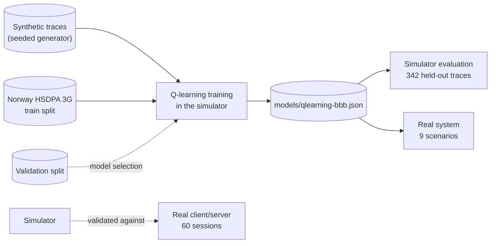
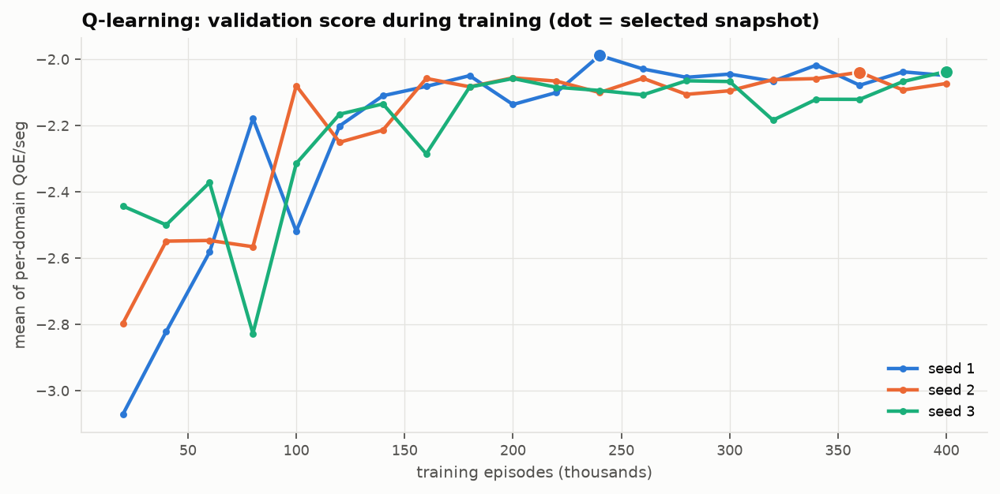
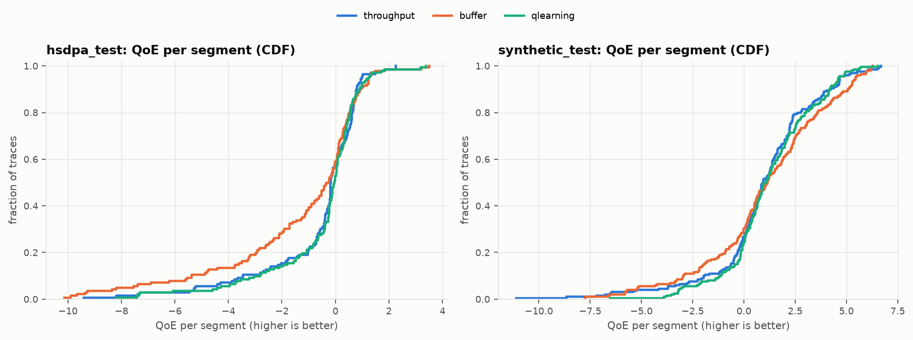
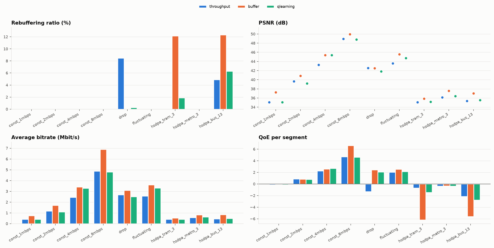
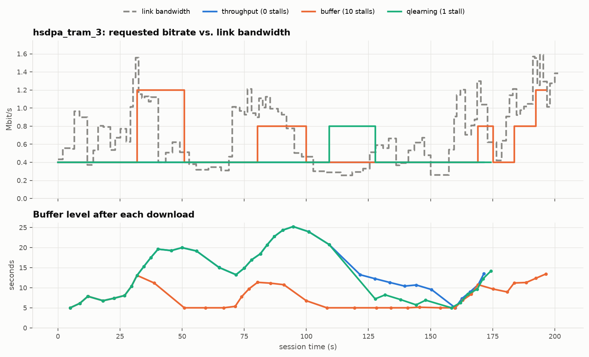

# Extension E-01: Intelligent ABR with Q-Learning

This document describes the reinforcement-learning ABR: a tabular Q-learning agent trained
offline in a validated simulator. It is evaluated on held-out real-world 3G traces and
synthetic traces, and in the real streaming system. It is compared with the two rule-based
algorithms of the base system: throughput-based (harmonic mean) and buffer-based (BBA-0).

## 1. Overview



| Component | Module / command |
| --- | --- |
| Simulator | `streamwise.sim.env` (`StreamingEnv`, `simulate`) |
| Agent | `streamwise.abr.qlearning` (`QLearningAbr`, ABR spec `qlearning`) |
| Training | `streamwise-sim train` (`streamwise.sim.train`) |
| Trace sets | `streamwise.sim.tracesets`, `scripts/fetch_hsdpa_traces.sh` |
| Evaluation | `streamwise-sim evaluate`, `streamwise-experiment run experiments/qlearning.toml` |
| Simulator validation | `streamwise-sim validate <experiment dir>` |

## 2. Simulator

Training needs hundreds of thousands of sessions, but a real session takes 3 minutes. The
simulator needs about 12 µs per segment (a whole session in under 0.5 ms), following exactly the rules of the
real client and server:

1. Before requesting segment *k*, wait until `buffer + d_k ≤ 30 s` (the buffer drains only
   while playing).
2. The ABR decides on the same `AbrState` the real client builds.
3. Download time is the time the link needs for the segment's bytes. The link model is the
   server's token bucket: the trace clock starts at connection, and up to 32 KiB leave
   immediately after an idle period. The handshake and the manifest use part of the initial
   burst.
4. While playing, the buffer drains during the download. If it runs dry, the session stalls
   until the segment arrives.
5. Playback starts after 5 s of buffered media.

**Validation against the real system.** All three real experiments (60 sessions, including
measured 3G traces and the Q-learning agent itself) were re-run in the simulator:

| Experiment | Sessions | Identical bitrate & switch count | \|ΔQoE/seg\| median | \|ΔQoE/seg\| max |
| --- | --- | --- | --- | --- |
| Main evaluation | 18 | 17 | 0.0005 | 0.011 |
| BBA sensitivity | 15 | 13 | 0.0004 | 0.137 |
| Q-learning comparison | 27 | 22 | 0.0006 | 0.484 |

The remaining differences are knife-edge decisions. The real system has a few milliseconds
of timing noise per download. When a throughput estimate lies exactly on a decision
threshold, that noise flips the decision. The largest case is Q-learning at a constant
4 Mbit/s: the measured rate sits on the agent's 4.0 Mbit/s bin edge, and the real and the
simulated session ended up on different sides of it.

## 3. Agent

**State.** Four discretized features, 3,234 states in total:

| Feature | Values |
| --- | --- |
| Previous level | 6 levels + "none" (first segment) |
| Buffer level | 11 bins: 2.5 s steps up to the 25 s download gate |
| Throughput estimate | Harmonic mean of the last 3 downloads; 13 roughly logarithmic bins (0.5 … 10 Mbit/s), plus "no measurement" |
| Throughput trend | Last download ÷ estimate: falling (< 0.75), steady, rising (> 1.25) |

The trend feature lets the agent react to a sudden drop after a single sample. A moving
average reacts only gradually, which is exactly the weakness that made throughput-based ABR
stall after the bandwidth drop in the main evaluation.

**Action.** One of the 6 levels.

**Reward.** The QoE contribution of the segment, using the same linear model as all reports:

```
r_k = q(R_k) − μ·stall_k − μ_s·startup_k − |q(R_k) − q(R_{k−1})|,   q(R) in Mbit/s, μ = μ_s = 8
```

The sum of the rewards over a session equals the session QoE exactly (checked by a unit
test).

**Learning.** Standard one-step Q-learning, `Q(s,a) ← Q(s,a) + α (r + γ·max_a' Q(s',a') − Q(s,a))`:

- the learning rate per state-action pair is `α = max(0.005, (1 + n)^−0.6)`;
- ε-greedy exploration decays linearly from 1.0 to 0.02 over 80 % of the 400,000 episodes;
- every episode starts at a random point of its trace.

**Inference.** At run time the agent picks `argmax` over the actions that were tried in that
state during training. A state never visited in training falls back to BBA. This happened in
0 % of the decisions on the test traces.

## 4. Training Protocol

| Split | Synthetic traces | Measured traces (Norway HSDPA 3G) |
| --- | --- | --- |
| Train | 1,000 (seeds 0–999) | 102 (seeded 80 % of the `train` files) |
| Validation | 100 (seeds 100000–100099) | 25 (the other 20 %) |
| Test | 200 (seeds 200000–200199) | 142 (the separate `test` files) |

The synthetic generator draws from three families: mean-reverting random walks (60 %),
step changes every 10–60 s (30 %) and constant rates (10 %), between 0.3 and 14 Mbit/s. The
HSDPA traces are real bandwidth logs from buses, trams, trains, ferries, metro and cars
around Oslo (Riiser et al., ACM MMSys 2013). They are fetched from a pinned commit by
`scripts/fetch_hsdpa_traces.sh` and not committed. Their mean bandwidth is low (median
1.15 Mbit/s on the test set), which is the regime where ABR decisions matter most.

**All model choices used the validation split only:**

1. **Hyperparameter sweep** (`scripts/sweep_qlearning.sh`, 400k episodes each):

   | γ | α floor | Best validation QoE/seg |
   | --- | --- | --- |
   | 0.90 | 0.005 | **−0.414** |
   | 0.95 | 0.005 | −0.420 |
   | 0.99 | 0.005 | −0.442 |
   | 0.95 | 0.02 | −0.508 (unstable: down to −1.98 between snapshots) |

   The two baselines scored −0.869 (throughput) and −0.931 (BBA) on the same split.

2. **Balanced domains.** In the sweep, measured traces were only 9 % of the training episodes
   and of the validation score. Training was therefore changed to pick a domain uniformly
   before picking a trace, and the validation score became the mean of the per-domain means.
3. **Seeds and snapshot.** Three seeds were trained with γ = 0.90 and an α floor of 0.005.
   Every 20,000 episodes the greedy policy was scored on validation, and the best snapshot of
   each run was kept. A visit-weighted ensemble of the three seeds scored worse on validation
   (−2.046) than the best single seed (seed 1, −1.988), so **seed 1 is the shipped model**.



## 5. Results on Held-Out Traces (Simulator)

`streamwise-sim evaluate --abr throughput --abr buffer --abr qlearning --reference qlearning`.
Every algorithm runs one session per trace, from the start of the trace.

### 5.1 Norway HSDPA 3G test set (142 real traces)

| ABR | QoE/seg (mean ± 95 % CI) | Bitrate (Mbit/s) | PSNR (dB) | Rebuffering | Stalls / session | Sessions with a stall | Switches |
|---|---|---|---|---|---|---|---|
| throughput | −0.620 ± 0.320 | 0.77 | 37.14 | 1.77 % | 1.68 | 52.8 % | 4.3 |
| buffer (BBA) | −1.320 ± 0.446 | 1.07 | 38.20 | 3.32 % | 2.75 | 61.3 % | 13.6 |
| **qlearning** | **−0.514 ± 0.304** | 0.81 | 37.03 | **1.44 %** | **1.24** | **29.6 %** | 6.3 |

### 5.2 Synthetic test set (200 traces)

| ABR | QoE/seg (mean ± 95 % CI) | Bitrate (Mbit/s) | PSNR (dB) | Rebuffering | Stalls / session | Sessions with a stall | Switches |
|---|---|---|---|---|---|---|---|
| throughput | 0.972 ± 0.364 | 2.37 | 41.76 | 1.77 % | 1.15 | 37.5 % | 6.5 |
| buffer (BBA) | 1.065 ± 0.411 | 3.00 | 43.01 | 2.39 % | 1.53 | 44.5 % | 11.8 |
| **qlearning** | **1.246 ± 0.295** | 2.43 | 41.62 | **1.02 %** | **0.69** | **21.0 %** | 9.0 |

### 5.3 Paired comparison

Each pair of algorithms is compared on the same traces; the gain is Q-learning minus the
baseline.

| Test set | vs. | Mean QoE/seg gain (95 % CI) | Median gain | Wins / ties / losses | Worst-decile QoE (Q-learning vs. baseline) |
|---|---|---|---|---|---|
| HSDPA | throughput | +0.106 (−0.011 … +0.223) | −0.033 | 48 / 7 / 87 | −2.80 vs. −3.39 |
| HSDPA | BBA | **+0.807 (+0.564 … +1.049)** | +0.117 | 86 / 3 / 53 | −2.80 vs. −5.33 |
| Synthetic | throughput | **+0.275 (+0.062 … +0.487)** | −0.011 | 89 / 6 / 105 | −1.11 vs. −1.90 |
| Synthetic | BBA | +0.181 (−0.024 … +0.386) | −0.161 | 76 / 1 / 123 | −1.11 vs. −2.93 |



**Interpretation.**

- **What was learned.** Q-learning learned a *risk-aware* policy. It has the highest mean QoE
  on both test sets and **halves the share of sessions that stall at all** (29.6 % vs. 52.8 %
  and 61.3 % on real 3G traces). Its worst sessions are much better than either baseline's,
  as the left tail of the CDF shows.
- **Mean vs. median.** The gain comes from avoiding expensive stalls, not from higher quality
  everywhere. On a typical trace it is about as good as the best baseline, so the median gain
  is around zero, and it often loses a little by picking a slightly lower level. It wins big
  where a baseline would stall. Since one second of stalling costs as much as one segment at
  the top quality, the mean QoE rewards this trade-off.
- **Significance.** Two of the four comparisons are statistically significant at 95 %. The
  other two (vs. throughput on HSDPA, vs. BBA on synthetic) are positive, but their
  confidence intervals include zero.
- **Seed robustness.** The other two seeds, which were not selected, scored −0.441 and
  −0.444 on the HSDPA test set and 1.261 and 1.198 on the synthetic test set. Every seed
  beats both baselines in both domains, so the improvement does not depend on a lucky seed.

## 6. Results in the Real System

`streamwise-experiment run experiments/qlearning.toml`: the six standard scenarios plus three
held-out HSDPA test traces at the 25th, 50th and 75th percentile of mean bandwidth, streamed
through the real server and client.

| Scenario | throughput | buffer (BBA) | qlearning |
| --- | --- | --- | --- |
| const 1 Mbit/s | −0.156 | **−0.111** | −0.163 |
| const 2 Mbit/s | **0.878** | 0.819 | 0.788 |
| const 4 Mbit/s | 2.244 | 2.577 | **2.678** |
| const 8 Mbit/s | 4.675 | **6.605** | 4.605 |
| drop 8→1 Mbit/s | −1.335 (5 stalls) | **2.438** (0 stalls) | 2.064 (1 stall) |
| fluctuating | 2.041 | **2.529** | 2.148 |
| HSDPA tram_3 (0.88 Mbit/s) | **−0.697** (0 stalls) | −6.207 (10 stalls) | −1.474 (1 stall) |
| HSDPA metro_3 (1.15 Mbit/s) | −0.366 | **−0.340** | −0.360 |
| HSDPA bus_13 (1.62 Mbit/s) | **−2.157** (4 stalls) | −5.612 (6 stalls) | −2.792 (4 stalls) |
| **Mean over 9 scenarios** | 0.570 | 0.300 | **0.833** |



The real system shows the same pattern as the simulator. No algorithm wins everywhere, but
each rule-based algorithm has a scenario where it fails badly, and Q-learning has none:

- throughput-based ABR stalls 5 times after the bandwidth drop;
- BBA stalls 10 times on the tram trace.

Q-learning is never far from the best algorithm in any scenario and has the best mean.



On the tram trace (0.25–1.6 Mbit/s), BBA climbs to 360p or 480p whenever its buffer allows
and then stalls when the link collapses. Q-learning stays at 240p, takes one 360p step with
21 s of buffer, and pays for it with one stall when the link falls to 0.3 Mbit/s.

## 7. Limitations

- **Single video.** The model is trained for one bitrate ladder. `QLearningAbr` refuses to
  run on a manifest whose ladder differs, so it must be retrained for other content.
- **Small real-system sample.** Nine real-system scenarios are illustrative; statistical
  claims rest on the 342 held-out simulator traces, made credible by the simulator
  validation in §2.
- **Tabular state.** Hard bin edges make decisions sensitive to small throughput changes near
  an edge (§2). A function approximator such as DQN would generalize more smoothly; the
  simulator and the evaluation tooling support that directly.

## 8. Reproducing

```bash
scripts/fetch_hsdpa_traces.sh                         # measured traces -> traces/hsdpa
scripts/sweep_qlearning.sh                            # hyperparameter sweep (~6 min)
streamwise-sim train --seed 1 --out models/qlearning-bbb.json   # ~6 min
streamwise-sim evaluate --abr throughput --abr buffer --abr qlearning --reference qlearning
streamwise-sim validate results/default               # simulator vs. real system
streamwise-experiment run experiments/qlearning.toml  # real system, ~4 min
```

Training is deterministic for a given seed, trace set and manifest.
