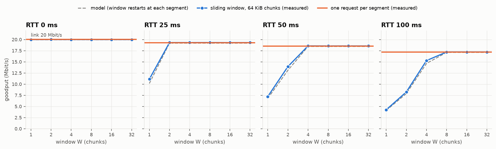
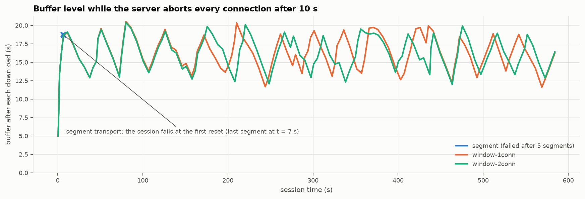

# Extension E-03: Sliding-Window Streaming

With `--transport window`, the client fetches every segment as fixed-size chunks. It uses a
receiver-side sliding window over one or more TCP connections, reassembles the chunks in
order, and requests again only the chunks lost when a connection fails. A long stream
therefore keeps playing through connection failures that would end a session of the
segment transport, and memory stays bounded however long the stream is.

| Component | Location |
| --- | --- |
| `GET_CHUNK` / `CHUNK` messages | `streamwise.common.protocol` |
| Pipelined server, `--delay-ms`, `--reset-after-s`, `client` shaping scope | `streamwise.server.app`, `streamwise.server.shaping` |
| Pipelined chunk requests on one connection | `StreamClient.get_chunk` (`streamwise.client.connection`) |
| Window, reassembly, selective repeat, connection pool | `streamwise.client.window` |
| Tests | `tests/test_window.py` |
| Evaluation | `streamwise-experiment window-bench` (`streamwise.experiments.windowbench`) |

## 1. Why a Window on Top of TCP

TCP already provides a reliable, ordered byte stream with its own sliding window, but only
within one connection. The segment transport inherits three limitations from that:

1. **A connection is a single point of failure.** A reset, a NAT timeout or a network
   handover ends the session, and the segment in flight is lost entirely.
2. **The unit of retry is a whole segment.** A 5 MB segment that fails at 90 % has to be
   downloaded again from the start.
3. **One connection cannot spread a download over several paths.**

The application-level window addresses all three:

- the unit of transfer and retry is a chunk;
- chunks can travel over any connection;
- the receiver reassembles them in order.

## 2. Protocol

| Type | Value | Payload |
| --- | --- | --- |
| `GET_CHUNK` | 9 | `!QI` byte offset (8 B) and length (4 B), then the UTF-8 segment file name |
| `CHUNK` | 10 | the requested bytes (at most 1 MiB) |

- **Pipelining.** A client may send many requests before reading a response. On each
  connection the server runs a reader task that queues up to 256 requests, and it answers
  them strictly in request order. Beyond 256 queued requests, TCP flow control pushes back.
- **Invalid ranges.** An invalid range gets `ERROR 416`, and the connection stays usable.
- **Encryption.** Chunks work unchanged with encryption: every `CHUNK` is a normal
  AES-GCM record.
- **Logging.** The transmission log records one row per chunk, with its `chunk_offset`.

```
client                                    server
GET_CHUNK seg-7 [0+64K]        ─┐
GET_CHUNK seg-7 [64K+64K]       │ window W = 4: up to 4 requests outstanding
GET_CHUNK seg-7 [128K+64K]      │
GET_CHUNK seg-7 [192K+64K]     ─┘
                               ◀── CHUNK [0+64K]          base 0 → 1, request [256K+64K]
                               ◀── CHUNK [64K+64K]        base 1 → 2, request [320K+64K]
                               ...
```

## 3. Receiver

The window for a segment of `n` chunks is `[base, base + W)`. Here `base` is the first chunk
not yet delivered in order.

- **Sending.** A chunk may be requested only if it lies inside the window. Retransmissions
  come first, and each request goes to the connection with the fewest requests in flight.
- **Receiving.** A chunk that arrives out of order is held in the reassembly buffer.
  - With several connections this happens all the time.
  - Within one connection, chunks always arrive in order.
  - When chunk `base` arrives, the contiguous run moves to the segment and the window
    slides forward.
- **Bounded state.**
  - The requests in flight and the held chunks together never exceed `W`. Tests check both
    the requests in flight and the peak reassembly occupancy.
  - Out-of-order memory is therefore at most `W × chunk` (1 MiB by default), independent of
    the length of the stream.
  - Chunks are addressed by `(file name, byte offset)`, so sequence numbers never wrap.
- **Selective repeat.** A request can fail with a connection error, a timeout, a broken
  frame or a decryption failure. Its chunk then goes back into the retransmission list, the
  connection is closed and re-established in the background, and the other connections
  carry on.
  - Backoff: 0.1 s, doubling up to 5 s. A connection is given up after 8 consecutive failed
    attempts, and the session fails only when every connection has been given up.
  - Application errors such as `404` or `416` are not retried.
- **Pipelining on one connection.** `StreamClient.get_chunk` writes its request at once.
  Responses are read in send order: each call waits for the previous one's response to be
  consumed. If a read fails or is cancelled, the response stream is out of step, so the
  connection is marked broken and replaced.
- **Throughput for the ABR.** The ABR still sees one throughput sample per segment: the
  segment's bytes divided by the time from its first request to its last chunk. The ABR
  interface and every algorithm, including Q-learning, are unchanged.

**Shaping with several connections.** With `--shaping-scope connection`, every connection
would get its own bandwidth limit, and N connections would get N times the bandwidth. The
`client` scope shares one token bucket among all connections of a client name, which models
the client's access link. All window experiments use it.

## 4. Throughput vs. Window Size and RTT

`streamwise-experiment window-bench` downloads three 720p segments (1.66 MB each) over a
20 Mbit/s link with 64 KiB chunks, for every combination of window size and emulated
round-trip time (`--delay-ms`).

The model (`windowbench.segment_time`) predicts the time per segment of `S` bytes in `n`
chunks of `L` bytes:

```
T = RTT + S/C + (n − 1) · max(0, (RTT + L/C)/W − L/C)
```

The first chunk arrives after one RTT. After that, a chunk completes every `L/C` if the
window covers the bandwidth-delay product, and every `(RTT + L/C)/W` if it does not.

Measured goodput in Mbit/s, with the model in parentheses:

| RTT | W=1 | W=2 | W=4 | W=8 | W=16 | W=32 | one request per segment |
|---|---|---|---|---|---|---|---|
| 0 ms | 20.0 (20.0) | 20.0 (20.0) | 20.0 (20.0) | 20.0 (20.0) | 20.0 (20.0) | 20.0 (20.0) | 20.0 (20.0) |
| 25 ms | 11.1 (10.2) | 19.3 (19.2) | 19.3 (19.2) | 19.3 (19.2) | 19.3 (19.2) | 19.3 (19.2) | 19.3 (19.2) |
| 50 ms | 7.2 (6.8) | 13.9 (13.1) | 18.6 (18.4) | 18.6 (18.4) | 18.6 (18.4) | 18.6 (18.4) | 18.5 (18.4) |
| 100 ms | 4.2 (4.1) | 8.2 (7.9) | 15.3 (14.6) | 17.2 (17.1) | 17.2 (17.1) | 17.2 (17.1) | 17.2 (17.1) |



- **Stop-and-wait** (W = 1) collapses as the RTT grows: 4.2 Mbit/s at 100 ms, one chunk
  per RTT.
- **The window needed** to fill the link is the bandwidth-delay product in chunks plus one.
  At 100 ms that is 250 kB, so about 4 chunks of 64 KiB plus one. W = 8 is enough, and
  larger windows gain nothing. The default W = 16 covers RTTs up to about 400 ms at
  20 Mbit/s.
- **The model matches** within 0.9 Mbit/s everywhere. At small windows the measurements are
  slightly higher, because the 16 KiB token bucket refills while the link waits for a
  request, so part of each chunk leaves as a burst.
- **Segment boundaries cost one RTT each.** Even a full window falls short of the link rate
  at 100 ms: 17.2 instead of 20 Mbit/s. The window starts empty at every segment, because
  the ABR chooses the next segment's level only after the current one is complete. The
  per-segment transport pays the same RTT, so a large enough window matches it but cannot
  beat it on one connection (see §7).

## 5. Long Stream with Connection Failures

`bbblong` is the first 10 minutes of Big Buck Bunny: 120 segments, the same ladder. It is
streamed in real time at 4 Mbit/s with the buffer-based ABR. The server aborts every
connection 30 s or 10 s after it opens (`--reset-after-s`). The three transports run at the
same time on separate servers:

| Transport | Resets | Status | Segments played | Avg bitrate (kbps) | Stalls | QoE/seg | Reconnects | Lost in transit |
|---|---|---|---|---|---|---|---|---|
| segment | none | completed | 120 | 3687 | 0 | 3.006 | – | 0 |
| window, 1 connection | none | completed | 120 | 3708 | 0 | 3.027 | 0 | 0 |
| window, 2 connections | none | completed | 120 | 3708 | 0 | 3.026 | 0 | 0 |
| segment | every 30 s | **failed** at the first reset | 8 | – | – | – | – | 2.59 MB (17 %) |
| window, 1 connection | every 30 s | completed | 120 | 3708 | **0** | 3.068 | 19 | 0.74 MB (0.25 %) |
| window, 2 connections | every 30 s | completed | 120 | 3697 | **0** | 2.994 | 38 | 1.44 MB (0.49 %) |
| segment | every 10 s | **failed** at the first reset | 5 | – | – | – | – | 1.59 MB (32 %) |
| window, 1 connection | every 10 s | completed | 120 | 3645 | **0** | 3.006 | 57 | 2.21 MB (0.76 %) |
| window, 2 connections | every 10 s | completed | 120 | 3645 | **0** | 3.006 | 114 | 3.80 MB (1.30 %) |

*Lost in transit*: bytes the server sent that did not end up in a delivered segment, as a
share of all bytes sent. For the window it is measured as server bytes minus delivered
bytes.



- **Seamless playback.**
  - With a connection killed every 10 s, the window transport played all 10 minutes,
    through 57 or 114 reconnects, without a single stall. Bitrate and QoE equal the runs
    without faults.
  - The segment transport cannot recover: its session ends at the first reset. In this
    experiment it does not even reach the 30th second.
- **Selective repeat is cheap.**
  - A reset loses only what was in flight on that connection: about 39 KB per reset, the
    partly sent chunk plus the bytes in the socket buffers. Overall that is 0.25–1.3 % of
    the bytes sent.
  - The window re-requested more, up to 50 MB over the session, because every chunk that
    was still queued at the server is requested again. Most of those chunks had not been
    sent yet, so they cost no bandwidth.
  - The segment transport loses the whole partial segment: 17–32 % of the bytes it sent.
- **Reconnects are fast compared to the buffer.** A reconnect takes a TCP handshake, the
  `HELLO`/`WELCOME` exchange and a 0.1 s backoff. The ABR keeps 12–20 s of buffer, so
  playback never comes close to stalling. Retransmissions still slow the affected segment
  down slightly, and the buffer-based ABR then picks a slightly lower level
  (3645 vs. 3708 kbps at 10 s resets).
- **One or two connections.** On a single access link (`client` shaping scope), a second
  connection does not add bandwidth. Each connection is reset on its own timer, so two
  connections see twice the resets and lose twice the in-flight data. Several connections
  pay off when they take different paths, for example over Wi-Fi and cellular. The window
  already spreads chunks over whichever connections are up, but the pool currently connects
  all of them to the same server address. Path selection belongs to extension E-04, which
  is not implemented.
- **Memory.** The window bounds out-of-order data to 16 × 64 KiB = 1 MiB. The playback
  cache holds at most a buffer's worth of segments. Neither grows with the length of the
  stream.

## 6. Verification

`tests/test_window.py` has 15 tests:

- **Protocol.**
  - The chunk request encoding round-trips.
  - The server answers pipelined requests in order, including `416` and `404` in the
    middle of a pipeline.
  - Ten concurrent `get_chunk` calls share one emulated RTT instead of paying ten.
- **Reassembly.** Out-of-order delivery is reassembled correctly, and duplicates are
  ignored.
- **End to end.**
  - Segments come back byte-identical for window sizes 1 to 64, chunk sizes that do not
    divide the segment, and 1 to 3 connections. The requests in flight never exceed W, and
    the reassembly buffer stays below W.
  - A server error is propagated, and the connection pool recovers afterwards.
- **Faults.** With resets every 0.15 s, segments still arrive intact: there are reconnects,
  retransmitted chunks, and `injected_reset` close reasons in the server log.
- **RTT.** At a 20 ms RTT, stop-and-wait needs at least one RTT per chunk, and W = 8 is more
  than 3× faster.
- **Shaping.** With the `client` scope, three connections together get the configured rate,
  not three times it.
- **Full session.** An encrypted session with the window transport completes through
  repeated resets, while a segment-transport session against the same server fails. The
  client log records the reconnects.
- **Model.** `segment_time` has the correct stop-and-wait and saturated limits.

## 7. Limitations

- **No prefetch across segment boundaries.** Each segment costs one RTT (§4), as with the
  per-segment transport. Requesting the next segment's first chunks while the current one
  finishes would need the ABR decision earlier, before the last throughput sample exists.
- **Losses are application-level only.** `--reset-after-s` models connection failures, not
  packet loss; TCP still recovers packet loss inside each connection. Loopback has no real
  RTT, so `--delay-ms` emulates it at the server.
- **More connections cost more on resets.** A reset still loses the data in flight on that
  connection, and more connections see more resets in total (§5).

## 8. Reproducing

```bash
streamwise-media segment media/raw/bbb_sunflower_1080p_30fps_normal.mp4 --name bbblong --start 0 --duration 600 --no-quality
pytest tests/test_window.py
streamwise-experiment window-bench                 # RTT sweep (~1 min) + fault runs (~11 min)
```
