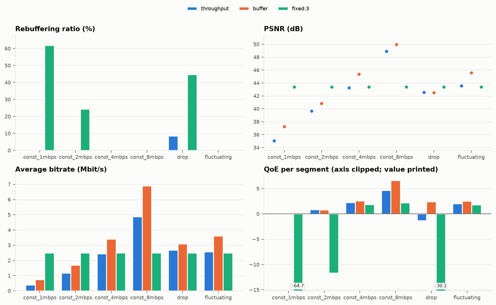
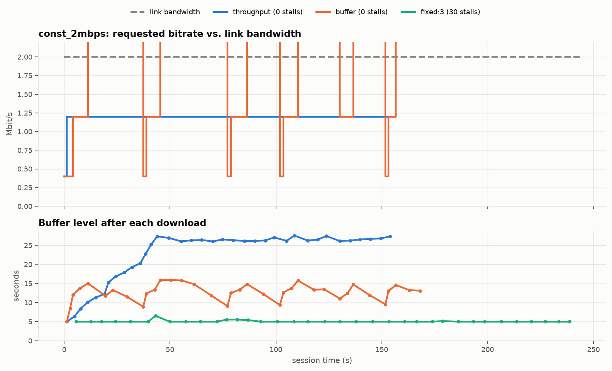
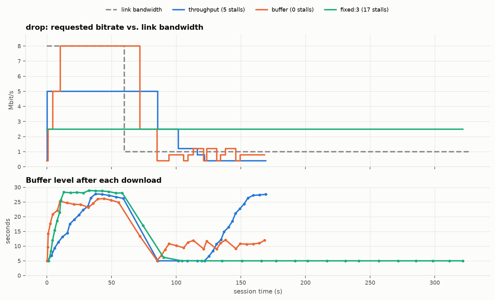
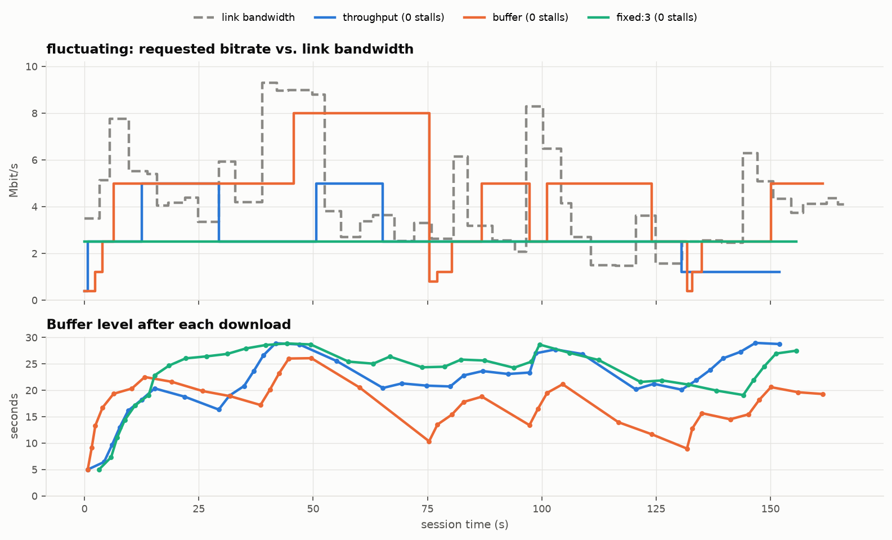
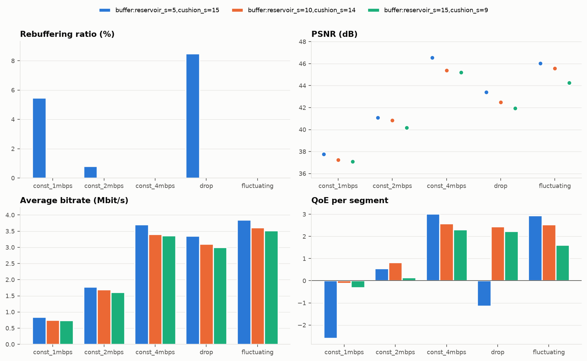

# StreamWise Test Report

This report covers the functional verification of the system, and the comparison of
rebuffering, PSNR and QoE under different network bandwidths (requirements T-01 to T-04).
Definitions of all metrics are in the [design document, §7](design.md#7-metrics-and-qoe).

## 1. Test Environment

| Item | Value |
| --- | --- |
| Machine | 32 logical CPUs, WSL2 (Linux 6.6.114), loopback networking |
| Software | Python 3.12.16, FFmpeg 9.0.2 (conda environment `streamwise`) |
| Video | Big Buck Bunny 0:30–3:30 (180 s), 36 segments of 5 s |
| Ladder | 240p/400k, 360p/800k, 480p/1200k, 720p/2500k, 1080p/5000k, 1080p/8000k (measured 0.60–7.97 Mbit/s) |
| Client | 30 s buffer cap, playback starts after 5 s of buffered media |
| Bandwidth emulation | Server-side token bucket, one independent link per client (`--shaping-scope connection`) |

## 2. Functional Verification

### 2.1 Automated Tests

`pytest` runs 63 tests in about 13 s. Every push also runs them, together with `ruff`, in
GitHub Actions CI on a clean Ubuntu runner.

| Area | What is verified |
| --- | --- |
| Protocol | Exact 16-byte header layout; multi-message round trip; detection of CRC mismatch, bad magic/version/type, oversized and truncated messages |
| Naming / manifest | Name round trip; rejection of path-traversal and non-canonical names; manifest validation |
| Shaping | Trace parsing and validation; exact integration across rate changes and outages; token-bucket pacing within 10 % of the target; fair sharing of one bucket by two senders |
| ABR | Throughput rule at several bandwidths; BBA reservoir, cushion and hysteresis; monotonic BBA mapping; spec-string factory |
| Playback model | Startup delay; stall timing from playhead exhaustion to segment arrival; buffer level; waiting for buffer space; out-of-order rejection |
| Metrics | Rebuffering ratio, switches and QoE against hand-computed values |
| End to end | **3 concurrent clients** (throughput, buffer, fixed) against a shaped server, all completing with correct server and client logs; stalls at a fixed top level on a slow link; down-switching after a bandwidth drop; 404s and path traversal attempts; garbage bytes, an abrupt disconnect mid-transfer and an idle connection that do not affect a concurrent client; unreachable server; corrupt media detection |
| Cache | After every end-to-end session `download/` no longer exists; segments are deleted after playback |
| Media | On a synthetic clip: segment count, 25 frames per segment with a key frame first, error-free decoding of a stream mixing levels, PSNR ordering between levels |

### 2.2 Shaping Accuracy

The emulated bandwidth was checked against the server's transmission log (all segments over
400 kB in the main experiment):

| Configured | Segments | Mean measured | Min | Max |
| --- | --- | --- | --- | --- |
| 1 Mbit/s | 76 | 1.010 Mbit/s | 1.000 | 1.086 |
| 2 Mbit/s | 101 | 2.019 Mbit/s | 2.000 | 2.106 |
| 4 Mbit/s | 104 | 4.037 Mbit/s | 4.000 | 4.107 |
| 8 Mbit/s | 104 | 8.067 Mbit/s | 7.880 | 8.230 |

The mean is within 1 % of the target. The small excess comes from the 32 KiB initial burst
of each token bucket, which matters most for small segments.

### 2.3 Concurrency and Demo

Three clients with player windows streamed concurrently through `scripts/demo.sh` on one
shared link of 30 Mbit/s that dropped to 3 Mbit/s. All three played to the end. The
throughput-based clients stalled once (about 2.2 s) right after the drop, and the
buffer-based client did not stall. Each experiment in §3 also runs 15–18 client processes
concurrently against 5–6 servers, and no session failed.

## 3. ABR Comparison under Different Bandwidths

**Setup** (`experiments/default.toml`): six network scenarios × three algorithms, one run
each:

- Scenarios: constant 1, 2, 4 and 8 Mbit/s; `drop` (8 Mbit/s, then 1 Mbit/s from t = 60 s);
  `fluctuating` (a seeded random walk between 0.4 and 12 Mbit/s, mean 3.5 Mbit/s, changing
  every 2–6 s; `traces/fluctuating.txt`).
- Algorithms: `throughput` (harmonic mean of the last 5 downloads × 0.9), `buffer` (BBA-0,
  10 s reservoir, 14 s cushion), and the non-adaptive baseline `fixed:3` (always 720p,
  2.65 Mbit/s measured).

### 3.1 Summary

| Scenario | ABR | Avg bitrate (Mbit/s) | PSNR (dB) | Rebuffering (%) | Stalls | Startup (s) | Switches | QoE / segment |
|---|---|---|---|---|---|---|---|---|
| const 1 Mbit/s | throughput | 0.40 | 35.06 | **0.00** | 0 | 2.50 | 0 | -0.156 |
| | buffer | 0.74 | 37.24 | **0.00** | 0 | 2.50 | 20 | **-0.112** |
| | fixed 720p | 2.50 | 43.41 | 61.81 | 35 | 11.10 | 0 | -64.714 |
| const 2 Mbit/s | throughput | 1.18 | 39.66 | **0.00** | 0 | 1.25 | 1 | **0.877** |
| | buffer | 1.69 | 40.83 | **0.00** | 0 | 1.25 | 16 | 0.819 |
| | fixed 720p | 2.50 | 43.41 | 24.43 | 30 | 5.55 | 0 | -11.662 |
| const 4 Mbit/s | throughput | 2.44 | 43.25 | 0.00 | 0 | 0.63 | 1 | 2.244 |
| | buffer | 3.40 | 45.38 | 0.00 | 0 | 0.63 | 11 | **2.577** |
| | fixed 720p | 2.50 | 43.41 | 0.00 | 0 | 2.78 | 0 | 1.883 |
| const 8 Mbit/s | throughput | 4.87 | 48.93 | 0.00 | 0 | 0.32 | 1 | 4.674 |
| | buffer | 6.89 | 49.94 | 0.00 | 0 | 0.31 | 3 | **6.613** |
| | fixed 720p | 2.50 | 43.41 | 0.00 | 0 | 1.39 | 0 | 2.191 |
| drop 8→1 Mbit/s | throughput | 2.69 | 42.55 | 8.46 | 5 | 0.31 | 5 | -1.335 |
| | buffer | 3.10 | 42.50 | **0.00** | 0 | 0.31 | 16 | **2.438** |
| | fixed 720p | 2.50 | 43.41 | 44.66 | 17 | 1.39 | 0 | -30.092 |
| fluctuating | throughput | 2.57 | 43.56 | 0.00 | 0 | 0.72 | 6 | 2.041 |
| | buffer | 3.61 | 45.56 | 0.00 | 0 | 0.72 | 15 | **2.530** |
| | fixed 720p | 2.50 | 43.41 | 0.00 | 0 | 3.17 | 0 | 1.795 |



### 3.2 Rebuffering and PSNR versus Bandwidth

Both adaptive algorithms play the whole video **without a single stall at every constant
bandwidth from 1 to 8 Mbit/s**. Their PSNR rises with the available bandwidth:

| Bandwidth | throughput PSNR | buffer PSNR | fixed 720p PSNR | fixed 720p rebuffering |
| --- | --- | --- | --- | --- |
| 1 Mbit/s | 35.06 dB | 37.24 dB | 43.41 dB | 61.8 % |
| 2 Mbit/s | 39.66 dB | 40.83 dB | 43.41 dB | 24.4 % |
| 4 Mbit/s | 43.25 dB | 45.38 dB | 43.41 dB | 0 % |
| 8 Mbit/s | 48.93 dB | 49.94 dB | 43.41 dB | 0 % |

- **The fixed baseline shows why ABR is needed.** Its PSNR never changes, but below its
  2.65 Mbit/s requirement the video is frozen for 24 % (2 Mbit/s) to 62 % (1 Mbit/s) of the
  viewing time. Above that requirement it wastes bandwidth: at 8 Mbit/s it is 5.5–6.5 dB
  below the adaptive clients. PSNR alone does not capture stalls, which is why QoE combines
  quality, stalls and smoothness.
- **Throughput-based ABR is conservative.** It only picks a level whose bandwidth fits under
  90 % of the estimate. At 1 Mbit/s that leaves 240p (360p needs 0.99 Mbit/s); at 4 Mbit/s
  it leaves 720p, because 1080p/5000k needs 5.04 Mbit/s. At a constant bandwidth it switches
  at most once, after the first segment.
- **Buffer-based ABR uses the buffer to exceed the conservative choice.** At 4 Mbit/s it
  alternates between 720p and 1080p and gains 2.1 dB of PSNR, still without stalls. The
  price is many switches (11–20 at constant bandwidths below 8 Mbit/s): whenever the link
  rate lies between two levels, BBA oscillates between them. That is why throughput-based
  ABR has the slightly higher QoE at 2 Mbit/s (0.877 vs 0.819), where the switching penalty
  outweighs BBA's quality gain.



### 3.3 Sudden Bandwidth Drop (8 → 1 Mbit/s at t = 60 s)



- **Buffer-based (0 stalls).** At the drop it had about 25 s of buffer. While the buffer
  drained it stayed at 1080p and then 720p. Once the buffer fell below the 10 s reservoir it
  went straight to 240p, and then it kept the buffer between 9 and 12 s by alternating
  between 240p and 480p.
- **Throughput-based (5 stalls, 16.6 s in total).** The client log shows the classic weakness
  of history-based estimation:

  | seq | Level | Requested at | Download time | Buffer before → after |
  | --- | --- | --- | --- | --- |
  | 17 | 1080p/5000k | 60.3 s (0.3 s after the drop) | 25.5 s | 25.0 → 5.0 s (0.5 s stall) |
  | 18 | 720p/2500k | 85.8 s | 15.8 s | 5.0 → 5.0 s (10.8 s stall) |
  | 19 | 480p/1200k | 101.6 s | 7.1 s | 5.0 → 5.0 s (2.1 s stall) |
  | 20 | 480p/1200k | 108.8 s | 7.6 s | 5.0 → 5.0 s (2.6 s stall) |
  | 21 | 360p/800k | 116.3 s | 5.6 s | 5.0 → 5.0 s (0.6 s stall) |
  | 22 | 240p/400k | 121.9 s | 3.4 s | 5.0 → 6.6 s |

  The full buffer almost absorbed the 1080p segment already in flight. After that, the harmonic
  mean of the last five samples still contained four 8 Mbit/s samples, so the estimate fell
  only gradually: it took five segments to reach a sustainable level, and each of those
  segments stalled.
- **Fixed 720p (17 stalls, 44.7 %).** Every segment after the drop needed about 13 s to
  download, i.e. 2.65 times its playback time.

### 3.4 Fluctuating Bandwidth



The trace varies between 1.5 and 9.3 Mbit/s during the session. No algorithm stalls. BBA
reaches the highest average bitrate (3.61 Mbit/s, 45.56 dB) because its 9–26 s buffer
rides out the dips. Throughput-based ABR follows the measured rate between 480p and 1080p
(mostly 720p) with 6 switches. The fixed 720p baseline happens to fit this trace, but at a lower QoE than both
adaptive algorithms.

## 4. BBA Parameter Sensitivity

In the first evaluation round, BBA used a 5 s reservoir and the ladder had no 240p level.
BBA then stalled 22 times at 1 Mbit/s, which led to two changes (see the
[design document](design.md#62-buffer-based-bba-0-huang-et-al-sigcomm-2014)):

- a 240p rung, so a 1 Mbit/s link has a sustainable level;
- a reservoir of two segments.

`experiments/bba_sensitivity.toml` isolates the reservoir effect on the final ladder:

| Scenario | reservoir 5 s / cushion 15 s | **10 s / 14 s (default)** | 15 s / 9 s |
| --- | --- | --- | --- |
| const 1 Mbit/s | 12 stalls, 5.46 %, QoE -2.589 | 0 stalls, QoE **-0.112** | 0 stalls, QoE -0.315 |
| const 2 Mbit/s | 2 stalls, 0.81 %, QoE 0.545 | 0 stalls, QoE **0.819** | 0 stalls, QoE 0.143 |
| const 4 Mbit/s | 0 stalls, QoE **3.019** | 0 stalls, QoE 2.577 | 0 stalls, QoE 2.305 |
| drop | 7 stalls, 8.48 %, QoE -1.148 | 0 stalls, QoE **2.438** | 0 stalls, QoE 2.230 |
| fluctuating | 0 stalls, QoE **2.946** | 0 stalls, QoE 2.530 | 0 stalls, QoE 1.613 |



A one-segment reservoir is too small. BBA then leaves the lowest level while the buffer still
holds only about one segment, and a single slow download stalls playback. It has the best
QoE only where bandwidth is plentiful. A 15 s reservoir is as safe as 10 s but stays at
low quality longer: it has a lower PSNR in every scenario. The 10 s default has no stalls
anywhere and the best QoE in all three constrained scenarios.

## 5. Q-Learning ABR (Extension E-01)

The learned ABR is evaluated separately in [intelligent-abr.md](intelligent-abr.md): on 342
held-out traces in a validated simulator, and in the real system on the six scenarios above
plus three measured 3G traces. In the real system it has the best mean QoE (0.833 per segment,
vs. 0.570 for throughput-based ABR and 0.300 for BBA). It also avoids the failure cases of both
rule-based algorithms: 1 stall instead of 5 after the bandwidth drop, and 1 instead of 10 on
the tram trace.

## 6. Encryption (Extension E-02)

`experiments/encryption.toml` repeats the main evaluation of §3 with every session encrypted
(AES-256-GCM). Every one of the 18 sessions has the same average bitrate, stalls, stall time
and switches as its plaintext counterpart. QoE per segment differs by at most 0.005. The
cost is about 1.5 ms of CPU to encrypt the largest segment and 16 bytes per message. The
tests, the security properties and the cost measurement are in [encryption.md](encryption.md).

## 7. Reproducibility and Limitations

- **Reproducibility.** The BBA 10 s / 14 s configuration ran twice, in the main and in the
  sensitivity experiment, and gave identical metrics in all five shared scenarios (e.g.
  drop: 3.10 Mbit/s, 42.50 dB, 0 stalls, 16 switches, QoE 2.438). With per-connection shaping
  the emulated link is deterministic, so one run per configuration is representative; the
  `repeats` setting supports more.
- **Emulation scope.** Bandwidth is limited at the sender in the application; loopback adds
  no meaningful latency or loss. Kernel-level emulation (`tc netem`) would add RTT and loss
  effects to TCP itself.
- **PSNR** is measured against the 1080p source after upscaling, and it ignores stalls; QoE
  is the combined indicator.
- **Single video.** Results hold for Big Buck Bunny's content complexity; other content
  shifts the bitrate–PSNR curve.

## 8. Packet Capture (T-04)

`tools/wireshark/streamwise.lua` decodes the protocol. It was checked on a synthetic capture
of a full session (HELLO, WELCOME, GET_MANIFEST, MANIFEST, GET_SEGMENT, a SEGMENT spanning
four TCP packets, a 404 ERROR, and BYE): all messages were decoded and reassembled
correctly. A live capture needs the user to be a member of the `wireshark` group. The
procedure is in the [user manual, §7](user-manual.md#7-packet-capture-with-wireshark).

> TODO (team): add screenshots of a live capture — the decoded message list and a TCP
> throughput graph across a bandwidth drop.

## 9. Reproducing the Results

```bash
streamwise-experiment run experiments/default.toml --out results/default
streamwise-experiment run experiments/bba_sensitivity.toml --out results/bba_sensitivity
streamwise-experiment run experiments/encryption.toml --out results/encryption
streamwise-experiment crypto-bench
```

Each run takes about 8 minutes. The output directories contain the summary tables, all
charts, and the raw SQLite logs.
